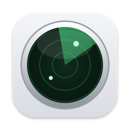
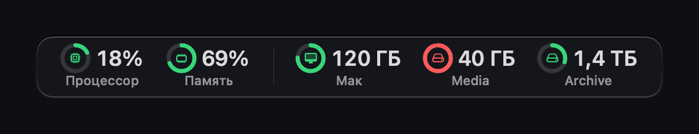
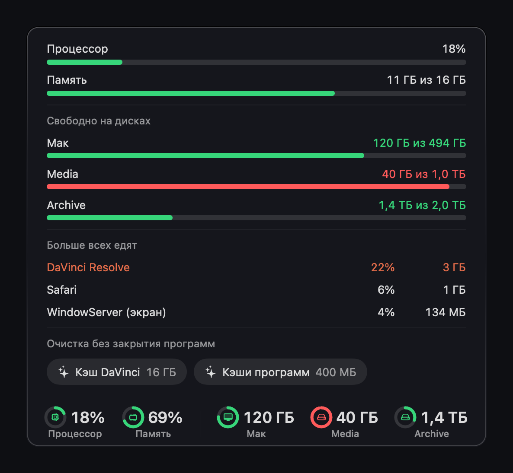

<p align="center"></p>

# Радар

Маленький монитор для macOS, который живёт рядом с Доком и показывает главное с одного взгляда: загрузку процессора, память, свободное место на дисках и программы, которые едят больше всех.

<p align="center"></p>

## Что умеет

- **Кольца-индикаторы:** процессор, память и каждый диск. Зелёный - нормально, жёлтый - напряжённо, красный - мало места или перегруз.
- **Щелчок раскрывает подробности:** полоски загрузки, свободное место по дискам и топ-3 программы по процессору и памяти (помощники одной программы складываются в неё).
- **Очистка без закрытия программ:**
  - кэш DaVinci Resolve - Resolve сам пересоздаст его при необходимости;
  - кэши только тех программ, которые сейчас закрыты (системные и инструменты рендера не трогаются).
- **Три положения** (правый клик): внизу у Дока, справа экрана, сверху по центру строки меню.
- **У Дока:** та же высота и скругление, что у Дока, следит за изменением его размера; можно перетащить вдоль низа экрана.
- **Лёгкий:** меньше 1% процессора и около 20 МБ памяти.
- Флешки и карты памяти не показываются, только диски.

<p align="center"></p>

## Установка

**[⬇ Скачать Радар (.dmg)](https://github.com/Emileminov/radar/releases/latest/download/Radar.dmg)** - подписано Developer ID и нотаризовано Apple. Открой .dmg и перетащи «Радар» в «Программы».

Нужны macOS 26 (Tahoe) и Apple Silicon.

### Сборка из исходников

Нужны Xcode Command Line Tools (`xcode-select --install`).

```bash
git clone https://github.com/Emileminov/radar.git
cd radar
./build.sh install
```

Автозапуск включается галочкой «Запускать вместе с системой» в меню по правому клику.

## Настройки

Папка кэша DaVinci Resolve, если она не в стандартном месте (`~/Movies/DaVinci Resolve/CacheClip`):

```bash
defaults write com.emil.radar davinciCache "/путь/к/CacheClip"
```

Для положения «сверху по центру» нужно разрешение «Мониторинг ввода»: иначе щелчок по самому верхнему краю экрана забирает строка меню.

## Устройство

Один файл `main.swift` (SwiftUI + AppKit), сборка `build.sh` без Xcode-проекта. Иконка рисуется скриптом `icon/make_icon.swift`.
Релиз с подписью Developer ID и нотаризацией: `release/project.yml` (XcodeGen) и `release/ExportOptions.plist`, сборка через `xcodebuild archive` / `-exportArchive` / `-exportNotarizedApp`.
